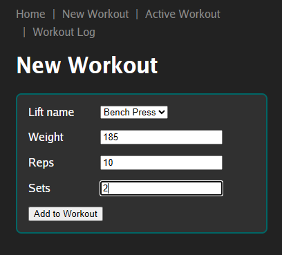
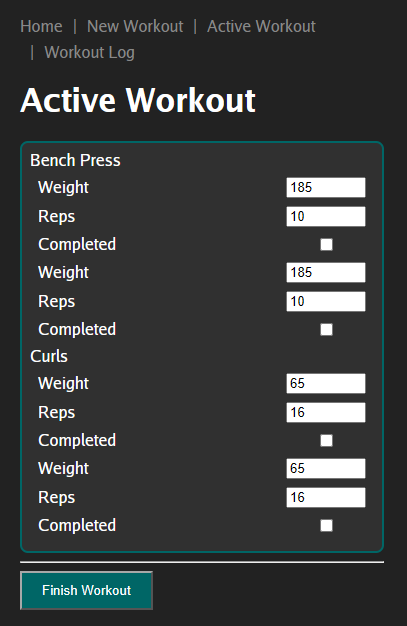
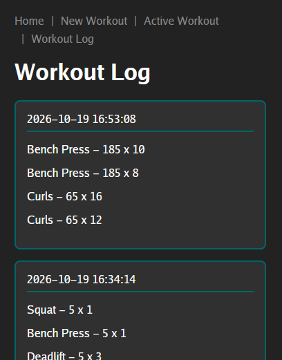

# Overview
Browser-based single-user workout app using go templating

# Requirements
- Go: 1.26.4 or newer; tested with 1.27.1
- Goose: required on your PATH; tested with 3.28.0, `go install github.com/pressly/goose/v3/cmd/goose@latest` installs to $GOPATH/bin
- SQLite: bundled through the Go driver; no separate SQLite installation required

# Quick Start
Clone this repository with `git clone --depth 1 https://github.com/edjohns1/workout-tracker`. From that directory, running via `run.sh` starts the server. Open your browser to http://localhost:8080/app to view the landing page.

# Basic Usage
- From the dropdown menu, select a workout and give the weight and expected number of reps. Continue adding until your workout has everything you need.
- In `Active Workout`, you should now see a list of what you've entered. The fields here can be edited as weight and reps often change from the expected plan. Use checkboxes to mark them off as you proceed.
- Finish Workout clears your active workout and takes you to Workout Log which displays your most recent 3 workouts.

# Limitations
- Best run on a single device, this works well via Termux.
- Site looks better on mobile than desktop. I'll assume you're a lot more likely to bring your phone to the gym and not your laptop.

# Screenshots

